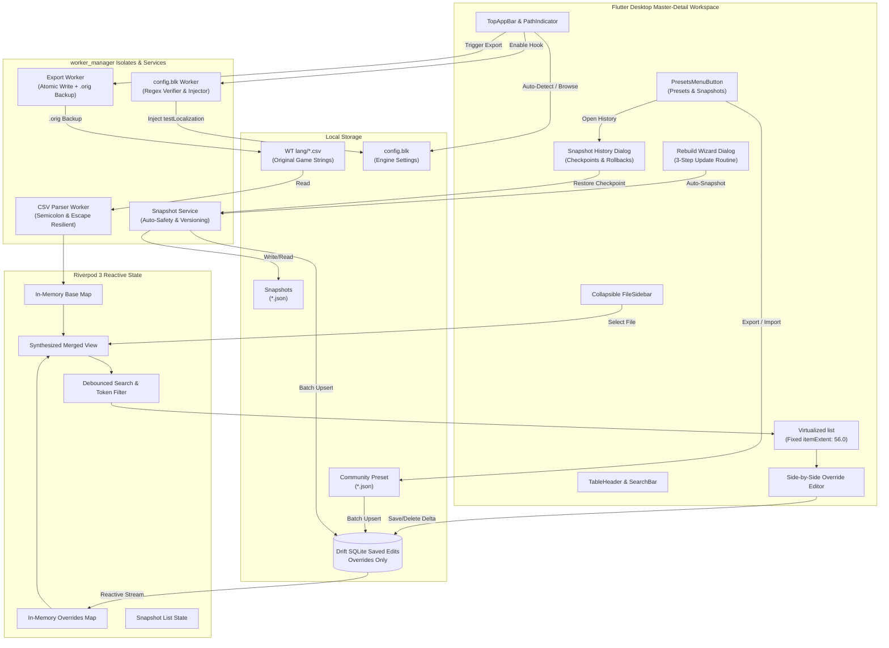

# Gramercy

<div align="center">
  
  <h3>War Thunder Localization Editor</h3>
  <p><em>"Gramercy!" &mdash; War Thunder Radio Command [T-3-4] ("Thank you!")</em></p>

  [](https://flutter.dev)
  [](https://riverpod.dev)
  [](https://drift.simonbinder.eu)
  [](https://github.com/Vonarian/gramercy)
  [](LICENSE)
  [](.github/workflows/ci.yml)
  [](https://github.com/Vonarian/gramercy/releases)
  [](https://flutter.dev)
</div>

---

## 1. What Gramercy Does

**Gramercy** is a desktop editor for War Thunder localization files on **Windows (primary), Linux, and macOS**. Your edits live in a local SQLite database outside the game folder and are written into `lang/*.csv` when you deploy.

Rename vehicles, edit kill feed and HUD messages, and share the result as a `.json` preset. Gramercy changes plain text files and the documented `testLocalization:b=yes` flag in `config.blk`. It does not attach to the game process, read its memory, or modify binaries or network traffic.

<div align="center">
  
</div>

### Stop Breaking Your Game: The Old Way vs. The Gramercy Way

| The Old Raw CSV Way | The Gramercy Way |
| :--- | :--- |
| **Manual File Hacking**: Digging through `<War Thunder>/lang/` with Notepad or Excel. | **Search**: Filter the localization strings as you type, without opening a spreadsheet. |
| **Crash Prone**: One misplaced semicolon or unescaped quote breaks the game on launch. | **Validated Export**: Quote-aware CSV parser, atomic write, and automatic `.orig` safety backups. |
| **Updates Wipe Everything**: When Gaijin drops a patch, all your custom names disappear or cause crashes. | **Edits Stay Separate**: Customizations live outside the game directory. Stock files are never permanently overwritten. |
| **No Safety Net**: Make a mistake or lose your edits, and you must reinstall or verify files via Steam. | **Snapshots**: Pre-update auto-snapshots and 1-click version rollback. |

---

## 2. Anti-Cheat and Safety

> [!NOTE]
> **Can I get banned for using custom localizations?**
> Custom localization is a documented Gaijin feature, enabled by `testLocalization:b=yes` in `config.blk`.

- **Documented hook**: War Thunder loads custom language files through that setting. Gramercy only turns it on.
- **No game process access**: Gramercy never attaches to War Thunder, reads its memory, or modifies binaries or network traffic. It writes CSVs and `config.blk`.
- **Text only**: every write goes through a quote-aware CSV parser, an atomic rename, and a `.orig` backup.
- **Auditable**: the source is GPL-3.0. Those file writes are the entire mechanism; there is no hidden binary path.

No ban reports are known to the maintainer. Future enforcement is Gaijin's and BattlEye's decision, not something this project can promise.

---

## 3. Key Player Features

### Saved edits (SQLite database outside the game folder)
Your customizations live in a local SQLite database in your user profile, outside the War Thunder directory. Stock files are never permanently overwritten, and game uninstalls or Steam updates cannot delete your overrides.

### String search
Search the full localization set, grouped by file (`units.csv`, `menu.csv`, `missions.csv`, `ui.csv`). Parsing and export run on `worker_manager` isolates off the UI thread, so typing stays responsive while dictionaries load.

### Minimal edits, always backed up
Only your changed strings are written into the game files; everything else stays vanilla. Every deploy writes a timestamped `.orig` backup before touching a CSV, through a same-directory atomic rename.

### Enable the localization hook
Gramercy detects your War Thunder installation and sets `testLocalization:b=yes` in `config.blk`, keeping a backup of the file. No manual text editing.

### Community presets
Share your setup with squadron mates or on WT Live as a `.json` file. Importing validates the schema and adds the overrides without touching unrelated strings.

### Snapshots
Before any cache purge or rebuild, Gramercy saves a timestamped snapshot of your edits to a file outside the game folder. Open **Snapshot History** to inspect or restore any previous state.

---

## 4. Major Update Survival Guide

When War Thunder releases a major update (*Alpha Strike*, *Dance of Dragons*, *Sons of Attila*, etc.), Gaijin introduces new vehicles, mechanics, and text strings. With traditional raw CSV edits, the game crashes or displays broken missing text IDs (e.g. `hud/kill_message_0`).

With **Gramercy**, your customizations survive every single update in 3 simple steps:

```
[1] Download Update ➔ [2] In Gramercy: Purge Cache ➔ [3] Launch WT to Hangar ➔ Reload & Apply
```

1. **Download the Game Update** in the War Thunder launcher or Steam.
2. In Gramercy's top bar, click the **Rebuild Game Strings** icon (`Sync` button):
   - **Click "Purge Cache"**: Gramercy automatically captures an **Automated Safety Snapshot** of your active customizations, verifies the game is closed, and clears out old CSVs and `localization.blk`.
3. **Launch War Thunder once** to the hangar:
   - The game detects `testLocalization:b=yes` and automatically dumps fresh, vanilla CSVs with the new update's strings.
   - Gramercy live-detects when the game finishes dumping.
4. **Click "Reload & Apply"**:
   - Gramercy reloads the fresh game strings and reapplies all your saved customizations to the new files.

> [!TIP]
> **Need to revert or check an earlier setup?**  
> Open **Presets ➔ Snapshot History...** from the top bar to browse all automatic and manual checkpoints, view customized string counts, and restore previous snapshots with one click.

---

## 5. Community Presets & Snapshot Checkpoints

### Sharing & Installing Presets

```
Top Bar ➔ [Presets Menu] ➔ "Export Preset (.json)" / "Import Preset (.json)"
```

- **Exporting**: Serializes all your active overrides across all CSV files into a compact, human-readable JSON file (`gramercy_preset_v1`). Perfect for sharing on WT Live, Discord, or with squadron mates.
- **Importing**: Select any community `.json` pack. Gramercy validates the schema and performs an atomic batch upsert into your saved edits without overwriting unrelated custom strings.

### Managing snapshots

```
Top Bar ➔ [Presets Menu] ➔ "Snapshot History..."
```

- **Automated Checkpoints**: Every time you purge the localization cache before an update, Gramercy automatically archives a `Pre-Update Purge` snapshot.
- **Manual Checkpoints**: Click **+ Create Snapshot** to capture a named restore point whenever you want to test experimental changes.
- **Rollback**: Select any snapshot and hit **Restore** to write those overrides back into your saved edits.

---

## 6. Windows SmartScreen Advisory

When downloading release executables on Windows, you may encounter a blue **Windows protected your PC** (SmartScreen) dialog:

> **Why does this happen?**  
> Gramercy is an independent, free open-source project. Code signing certificates for Windows cost hundreds of dollars per year, which we choose not to pass on to the community.
>
> **How to launch:**  
> Click **"More info"** ➔ Click **"Run anyway"**. The binary is built transparently via GitHub Actions from this open-source codebase.

### Verify Before You Run Anyway

"Run anyway" is precisely the reflex malware distributors train into people, so pair it with a checksum. We still don't code-sign the builds (see the certificate pricing above), but **every release publishes the three build archives *and* a `SHA256SUMS.txt` manifest alongside them**, so you can prove the archive you got is the one CI built:

```powershell
# Windows (cmd or PowerShell), replace v1.6.0 with your release tag
certutil -hashfile gramercy-windows-x64-v1.6.0.zip SHA256
```

```bash
# macOS / Linux, replace v1.6.0 with your release tag
shasum -a 256 gramercy-macos-v1.6.0.zip
# or verify every archive at once
sha256sum -c SHA256SUMS.txt
```

> [!TIP]
> **Where to find `SHA256SUMS.txt`:** open the [Releases page](https://github.com/Vonarian/gramercy/releases), open your release, and expand the **Assets** list under the release notes. The archives carry the release tag in their names (`gramercy-windows-x64-v1.6.0.zip`, `gramercy-linux-x64-v1.6.0.tar.gz`, `gramercy-macos-v1.6.0.zip`), and `SHA256SUMS.txt` is served next to them. Drop it into the same folder as your archive, hash the archive with the one-liner above, and compare against the matching line (digests match case-insensitively). Hash matches: the **"Run anyway"** click has been earned. Hash doesn't: the archive is not ours; delete it and re-download straight from the release page.

---

## 7. Under the Hood: Architecture

For developers, contributors, and technical modders, Gramercy is structured around an immutable delta synthesis pipeline:



### Architectural Highlights
- **Immutable Delta Synthesis**: Stock strings from `lang/*.csv` and user customizations from Drift SQLite never mix in permanent storage. The runtime synthesizes `BaseMap + OverrideMap` immutably on the fly.
- **Worker Isolates**: CPU-intensive CSV parsing, tokenized search filtering, and disk exports are dispatched to background isolates via `worker_manager`, so filtering runs while the UI stays responsive.
- **Safe Atomic Exports**: Exports write to temporary swap buffers and copy cleanly to destination CSVs after generating `.orig` backups, ensuring partial writes or power cuts cannot corrupt game files.

---

## 8. Download & Installation

### Pre-Built Desktop Binaries

Download the ready-to-run package for your platform from the **[Latest Release](https://github.com/Vonarian/gramercy/releases/latest)**. Each release also publishes a `SHA256SUMS.txt` checksum manifest next to the archives. See the [verification commands](#6-windows-smartscreen-advisory) in section 6 before you launch anything:

| Platform | Package Archive | Quick Start |
| :--- | :--- | :--- |
| **Windows** (10 / 11 x64) | `gramercy-windows-x64-v1.6.0.zip` | Extract archive, open folder, and run `gramercy.exe`. *(See [Windows SmartScreen Advisory](#6-windows-smartscreen-advisory))* |
| **Linux** (x64) | `gramercy-linux-x64-v1.6.0.tar.gz` | Extract with `tar -xzf <archive>` and run `./gramercy`. |
| **macOS** (Apple Silicon) | `gramercy-macos-v1.6.0.zip` | Extract archive and move `gramercy.app` to your Applications folder. |

> **Mobile note:** Gramercy is a desktop application and mobile builds are intentionally not shipped: the game's files live on your PC and phone OSes sandbox access to them. Rule of thumb: your edits and preset packs are just JSON; store a preset pack in any cloud-synced folder and re-import it on the desktop app.

---

## 9. Building from Source

### Prerequisites
- **Operating Systems**: Windows 10/11 (x64, primary), Linux (x64), or macOS (Apple Silicon)
- **War Thunder**: Installed via Steam or Gaijin Standalone Launcher
- **Flutter SDK**: `>= 3.24.0` (with desktop enabled)

### Build Instructions

1. **Clone the repository:**
   ```bash
   git clone git@github.com:Vonarian/gramercy.git
   cd gramercy
   ```

2. **Fetch dependencies:**
   ```bash
   flutter pub get
   ```

3. **Run code generation (Drift):**
   ```bash
   dart run build_runner build --delete-conflicting-outputs
   ```

4. **Run the desktop app:**
   ```bash
   flutter run -d windows
   ```

---

## 10. Quality Assurance & AGENTS.md Standards

Gramercy is maintained under strict engineering constraints defined in [`AGENTS.md`](AGENTS.md):
- **Test-Driven Development (TDD)**: all tests green, with line coverage enforced in CI and rising toward the ≥ 80% target across domain logic, DAOs, and state providers.
- **Strict LoC Ceilings**: Every non-test Dart source file ≤ 200 lines, methods ≤ 40 lines, widget `build()` methods ≤ 50 lines, and test files ≤ 400 lines.
- **Zero Static Analysis Warnings**: Verified with `flutter analyze`.
- **Mandatory Formatting**: Verified with `dart format --output=none --set-exit-if-changed .`.

```bash
# Verify formatting
dart format --output=none --set-exit-if-changed .

# Run static analysis
flutter analyze

# Run full test suite with coverage
flutter test --coverage
```

---

## 11. Security Acknowledgments

The localization pipeline was reviewed through a friendly, defensive security
audit by [**@cyberofficial**](https://github.com/cyberofficial). Thank you for
the responsible disclosure and for the detailed, reproducible report.

Their findings drove this release's hardening work:

- **Strict-basename validation** for imported community presets, closing a
  path-traversal overwrite vector in the *Reload & Apply* flow.
- **Symlink refusal** across CSV export, backups, and the available-files
  listing, so hostile packs cannot write through links.
- **Quote- and newline-aware CSV parsing/export**, landing writes **atomically**
  through same-directory temp renames (for both lang CSVs and `config.blk`).
- **Snapshot id containment** in the vault, plus log-forging scrubbing and
  supply-chain hygiene for CI (SHA-pinned actions, scoped permissions,
  release checksums).

---

## 12. License

Distributed under the terms of the **GNU General Public License v3.0**. See [`LICENSE`](LICENSE) for details.
